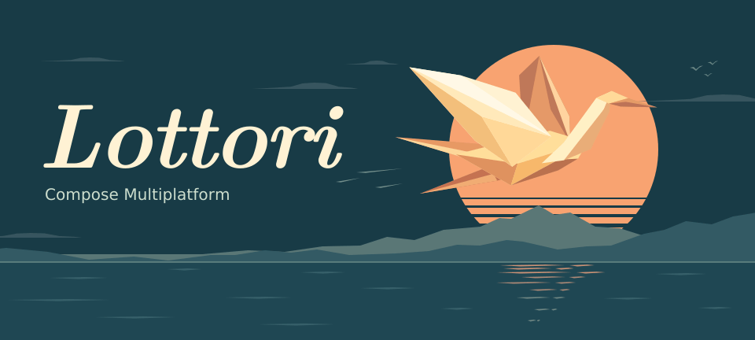
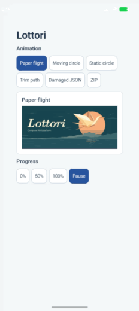
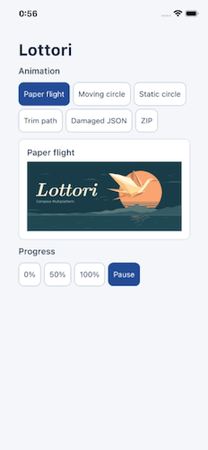

# Lottori

[English](README.md) · [한국어](README.ko.md) · **日本語**

[](docs/assets/paper-flight.json)

Lottori は、Android と iOS の Compose 画面に 2D Lottie アイコンを描画する Kotlin ライブラリです。自動再生のほか、ジェスチャーの進行度に合わせてフレームを指定できます。既定のモードでは、未対応の機能を含むファイルの読み込みに失敗すると、該当する JSON パスとレイヤー名を返します。アプリはその結果を使って代替アイコンを表示できます。

## サンプルアプリの画面収録

サンプルアプリを開くと、`paper-flight.json` から描画した **Paper flight** が 5.2 秒周期で繰り返し再生されます。kyounghyunko が ChatGPT を使ってこのアニメーションを制作しました。

| [Android エミュレータ (MP4)](docs/assets/paper-flight-android.mp4) | [iOS シミュレータ (MP4)](docs/assets/paper-flight-ios.mp4) |
| --- | --- |
| [](docs/assets/paper-flight-android.mp4) | [](docs/assets/paper-flight-ios.mp4) |

## 対応環境

| プラットフォーム | 最小バージョン | 再生を確認した環境 |
| --- | --- | --- |
| Android | ライブラリと通常のサンプルは Android 6.0（API 23）。Compottie 比較用アプリは Android 7.0（API 24） | Android 16 の Pixel 10 エミュレータ |
| iOS | プレイヤーをリンクした arm64 フレームワークは iOS 15.0。サンプルアプリのデプロイ対象は iOS 16.0 | iOS 26.5 の iPhone 17e シミュレータ |

最小バージョンは Android の `minSdk` と iOS 実機向けリリースバイナリの `minos` に基づきます。最小 OS バージョンでの再生は未検証です。iOS のビルドターゲットは `iosArm64`（実機）と `iosSimulatorArm64`（Apple Silicon シミュレータ）です。

| 依存関係・ツール | ビルドと検証に使用したバージョン |
| --- | --- |
| Kotlin Multiplatform、Compose Compiler プラグイン | 2.4.10 |
| Compose Multiplatform Runtime、UI、Foundation | 1.12.0 |
| kotlinx.serialization JSON、kotlinx.coroutines Core | いずれも 1.11.0 |
| Gradle、Android Gradle Plugin、JDK | 順に 9.5.0、9.1.1、21 |
| Android SDK | `compileSdk = 37`、サンプルアプリは `targetSdk = 36` |
| Xcode | 26.6 |

ライブラリを利用する側のアプリも同じ Kotlin と Compose のバージョンでビルドしました。それ以前の Kotlin との互換性は未検証です。Compottie lite 2.3.3 を使用するのは比較用のサンプルだけです。[バージョンカタログ](gradle/libs.versions.toml) · [ベンチマーク環境](docs/performance.md)

## アプリへの組み込み

### 1. 共通モジュールにプレイヤーを追加する

`0.1.0-SNAPSHOT` はローカル開発用です。アプリと Lottori のリポジトリを同じ親ディレクトリに配置した場合は、アプリの `settings.gradle.kts` に次の行を追加してください。

```kotlin
includeBuild("../lottori")
```

共通モジュールに Kotlin Multiplatform、Compose Compiler（`org.jetbrains.kotlin.plugin.compose`）、Compose Multiplatform（`org.jetbrains.compose`）のプラグインを適用し、`build.gradle.kts` にプレイヤーと Compose Resources の依存関係を追加します。

```kotlin
kotlin {
    sourceSets.commonMain.dependencies {
        implementation("com.ycgc.lottori:lottori:0.1.0-SNAPSHOT")
        implementation("org.jetbrains.compose.components:components-resources:1.12.0")
    }
}
```

プレーヤーには JSON デコーダーが含まれています。再生前にファイルを検査するには、`com.ycgc.lottori.core.decodeJson(bytes)` を呼び出し、`composition` と `diagnostics` を確認してください。

### 2. JSON を読み込み、指定したフレームを表示する

共通モジュールの `src/commonMain/composeResources/files/` に `paper-flight.json` を配置します。Android と iOS は同じファイルを使用します。そのモジュールが生成した `Res` をインポートしてください。Android KMP ライブラリのターゲットでは `kotlin { android { androidResources.enable = true } }` でリソースを有効にします。[折り鶴の JSON](docs/assets/paper-flight.json) · [Compose Resources の設定](https://kotlinlang.org/docs/multiplatform/compose-multiplatform-resources-setup.html)

```kotlin
import androidx.compose.runtime.Composable
import androidx.compose.ui.Modifier
import com.ycgc.lottori.*

@Composable
fun PaperFlight(
    progress: () -> Float,
    fallback: @Composable () -> Unit,
    modifier: Modifier = Modifier,
) {
    when (val state = rememberLottoriComposition("files/paper-flight.json", Res::readBytes)) {
        LottoriLoadState.Loading -> Unit
        is LottoriLoadState.Failed -> fallback()
        is LottoriLoadState.Ready -> LottoriAnimation(
            composition = state.composition,
            progress = progress,
            modifier = modifier,
            contentDescription = "空を飛ぶ折り鶴",
        )
    }
}
```

`PaperFlight` に `progress = { 0.5f }` を渡すと、折り鶴の飛行アニメーションの中間フレームが表示されます。ジェスチャーで操作する場合は、同じラムダから 0〜1 の進行度を返してください。`fallback` には読み込み失敗時に表示する静的アイコンを指定します。失敗の原因は `state.diagnostics` で確認できます。

リソースのフルパスがアニメーションを識別します。同じパスの内容を再読み込みするには、`rememberLottoriComposition(path, Res::readBytes, key = revision)` のように `key` を追加します。読み込んだ `composition` は複数のプレイヤーで共有できます。

### 3. 自動再生と一時停止を切り替える

自動再生するには、上の例の `Ready` 分岐で次のように呼び出してください。`iterations` の既定値は 1 です。指定した回数の再生が終わると、最後のフレームを保持します。

```kotlin
LottoriAnimation(
    composition = state.composition,
    modifier = modifier,
    iterations = 3,
    isPlaying = true,
    contentDescription = "空を飛ぶ折り鶴",
)
```

`isPlaying` を画面の状態に連動させると、`false` で一時停止し、`true` で同じ位置から再開します。ほかの UI でも進行度を使う場合は、`rememberLottoriPlayback` が返す `State<Float>` を共有してください。既定では `ContentScale.Fit` で中央に配置します。装飾用のアイコンには `contentDescription = null` を指定してください。

## ファイルの検査

JDK 21 と Android SDK Platform 37 をインストールし、リポジトリのルートで次のコマンドを実行してください。

```sh
./gradlew :lottori-check:run --args='docs/assets/paper-flight.json'
./gradlew :lottori-check:installDist
lottori-check/build/install/lottori-check/bin/lottori-check fixtures/trim-path.json
lottori-check/build/install/lottori-check/bin/lottori-check --preview fixtures/trim-path.json
```

既定のモードは `Strict` です。`trim-path.json` を検査すると、レイヤー `checkmark` の `$.layers[0].shapes[0].it[1]` で `TrimPath` を報告し、終了コード 1 を返します。`Preview` は診断を警告として残し、問題のあるレイヤーと、それに依存する子レイヤーを省略します。マットの場合は適用元と適用先の両方を省略します。マットの適用先を特定できない場合や親レイヤーへの参照が不正な場合は、どちらのモードでも失敗します。

## v0.1 の対応機能

| 項目 | 対応内容 | サンプルと参照画像 |
| --- | --- | --- |
| 入力 | ファイル名を伴わない UTF-8 JSON バイト列、Bodymovin の `v`、整数の仕様バージョン `ver`、未知のバージョンに対する警告 | [静止した円](fixtures/static-circle.json) · [参照フレーム](fixtures/frames/web/static-circle-000.png) |
| レイヤーと変換 | シェイプレイヤー、ヌルレイヤーを親とする変換、表示区間、既定の開始時刻と時間伸縮、アンカー、位置、拡大縮小、回転、不透明度、グループの入れ子 | [図形の重なりと親の回転](fixtures/render-order.json) · [参照フレーム](fixtures/frames/web/render-order-050.png) |
| 図形とスタイル | 矩形、角丸矩形、楕円、静的なベジェパス、単色の塗りと線、塗りつぶし規則、線端と線の結合、グループの不透明度 | [閉じた曲線と穴](fixtures/render-order.json) · [参照フレーム](fixtures/frames/web/render-order-050.png) |
| 時間 | スカラー値と 2D ベクトルの固定値、ホールド補間と線形補間、軸ごとの時間ベジェ補間、小数フレーム | [タイミングの例](fixtures/timing.json) · [中間フレーム](fixtures/frames/web/timing-050.png) |
| 再生 | 外部からの進行度指定、単発・反復再生、一時停止と再開、アクセシビリティの説明 | [移動する円](fixtures/moving-circle.json) · [0%](fixtures/frames/web/moving-circle-000.png) · [50%](fixtures/frames/web/moving-circle-050.png) · [100%](fixtures/frames/web/moving-circle-100.png) |

ZIP 入力は `UnsupportedContainer` として報告します。dotLottie の JSON 抽出、テーマ、ステートマシンには対応していません。次の描画機能も診断の対象です。

- プリコンポジション、平面・画像・テキスト・3D レイヤー、既定値以外の `st` と `sr`、タイムリマップ。
- 位置の次元分割、スキュー、自動方向付け、空間曲線に沿う移動、パスモーフィング、スター、トリムパス、リピーター。
- グラデーション、破線、ブレンドモード、マスク、マット、エクスプレッション、色のアニメーション。

メタデータは使用できます。逆方向のカスタムパスや、半透明のサブグループの境界をまたいで適用する親のスタイルも未対応として報告します。

## サンプルとテストの実行

**Moving circle** の再生区間は `[10, 40)`、フレームレートは 30 fps です。進行度 0%、50%、100% で表示するフレームは順に 10、25、39 で、円の中心の x 座標は 20、50、78 です。最後に表示できるフレームを超えた場合は、そのフレームを保持します。[サンプルアプリの実行手順](sample/README.ja.md)

```sh
./gradlew :lottori:jvmTest
./gradlew :lottori:iosSimulatorArm64Test
ANDROID_SERIAL=emulator-5554 ./gradlew :lottori:connectedAndroidDeviceTest
```

[参照画像の生成](docs/frames.md) · [配布サイズ](docs/size.md) · [再生性能](docs/performance.md) · [設計書](docs/Lottori-design.md)

## リリース候補の検証

ライブラリを検証用のローカル Maven リポジトリに公開し、別の利用側プロジェクトをビルドしてください。このプロジェクトは、公開した Android・iOS パッケージとその推移的依存関係を使用します。

```sh
./gradlew checkLegacyAbi publishAllPublicationsToVerificationRepository
./gradlew -p verification/consumer assembleAndroidMain compileKotlinIosArm64 compileKotlinIosSimulatorArm64
```

コードとプロジェクトで作成したサンプルデータのライセンスは Apache 2.0 です。機能を追加する場合は、最小の JSON、期待するフレーム、Android と iOS の描画結果を添え、上の対応表を更新してください。[ライセンス](LICENSE)
