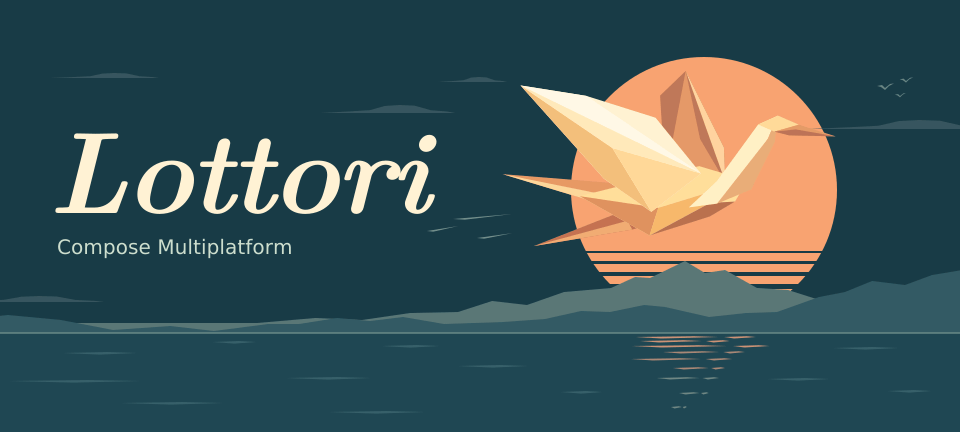
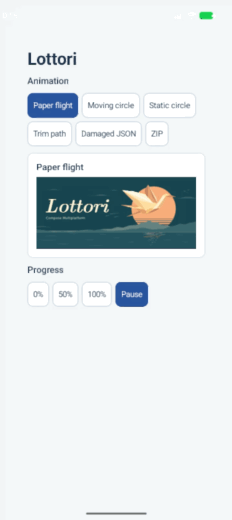
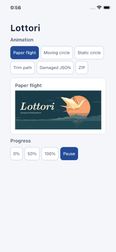

# Lottori

[English](README.md) · **한국어** · [日本語](README.ja.md)

[](docs/assets/paper-flight.json)

Lottori는 Android와 iOS의 Compose 화면에서 2D Lottie 아이콘을 그리는 Kotlin 라이브러리입니다. 앱은 제스처 진행률로 프레임을 지정하거나 재생 시계를 사용할 수 있습니다. 기본 모드는 미지원 기능이 있는 파일을 거부하고, 앱이 대체 아이콘을 표시할 수 있도록 JSON 경로와 레이어 이름을 돌려줍니다.

## 샘플 앱 화면 녹화

샘플 앱을 열면 `paper-flight.json`으로 그린 **Paper flight**가 5.2초 주기로 반복 재생됩니다. kyounghyunko가 ChatGPT를 사용해 이 애니메이션을 만들었습니다.

| [Android 에뮬레이터 (MP4)](docs/assets/paper-flight-android.mp4) | [iOS 시뮬레이터 (MP4)](docs/assets/paper-flight-ios.mp4) |
| --- | --- |
| [](docs/assets/paper-flight-android.mp4) | [](docs/assets/paper-flight-ios.mp4) |

## 지원 환경

| 플랫폼 | 최소 버전 | 재생을 확인한 환경 |
| --- | --- | --- |
| Android | 라이브러리와 일반 샘플은 Android 6.0(API 23). Compottie 비교용 샘플은 Android 7.0(API 24) | Android 16 · Pixel 10 에뮬레이터 |
| iOS | 플레이어를 링크한 arm64 프레임워크는 iOS 15.0. 샘플 앱의 배포 대상은 iOS 16.0 | iOS 26.5 · iPhone 17e 시뮬레이터 |

최소 버전은 Android의 `minSdk`와 iOS 기기용 릴리스 바이너리의 `minos` 기준입니다. 최소 OS에서의 재생은 아직 검증하지 않았습니다. iOS 빌드 대상은 `iosArm64`(실기기)와 `iosSimulatorArm64`(Apple Silicon 시뮬레이터)입니다.

| 항목 | 이 저장소에서 빌드·검증한 버전 |
| --- | --- |
| Kotlin Multiplatform · Compose Compiler 플러그인 | 2.4.10 |
| Compose Multiplatform Runtime · UI · Foundation | 1.12.0 |
| kotlinx.serialization JSON · kotlinx.coroutines Core | 각각 1.11.0 |
| Gradle · Android Gradle Plugin · JDK | 9.5.0 · 9.1.1 · 21 |
| Android SDK | `compileSdk = 37`, 샘플 앱 `targetSdk = 36` |
| Xcode | 26.6 |

소비 앱도 같은 Kotlin과 Compose 버전으로 빌드했습니다. 더 낮은 Kotlin 버전과의 호환성은 미검증입니다. Compottie lite 2.3.3은 성능 비교용 샘플에서만 사용합니다. [버전 카탈로그](gradle/libs.versions.toml) · [벤치마크 환경](docs/performance.md)

## 앱에서 사용하기

### 1. 공통 모듈에 라이브러리 추가하기

현재 `0.1.0-SNAPSHOT`은 로컬 개발용입니다. 앱과 Lottori 저장소가 같은 상위 디렉터리에 있다면 앱의 `settings.gradle.kts`에 다음 줄을 추가하세요.

```kotlin
includeBuild("../lottori")
```

Kotlin Multiplatform과 Compose Compiler 플러그인(`org.jetbrains.kotlin.plugin.compose`)을 사용하는 공통 모듈의 `build.gradle.kts`에 플레이어 의존성을 추가하세요.

```kotlin
kotlin {
    sourceSets.commonMain.dependencies {
        implementation("com.ycgc.lottori:lottori:0.1.0-SNAPSHOT")
    }
}
```

플레이어에 JSON 디코더가 포함되어 있습니다. 재생 전에 파일을 검사하려면 `com.ycgc.lottori.core.decodeJson(bytes)`를 호출해 `composition`과 `diagnostics`를 확인하세요.

### 2. JSON을 읽고 원하는 프레임 표시하기

예제 파일을 두 앱에 넣고 아래 공통 함수의 `readBytes`에 파일을 읽는 람다를 전달하세요. [종이학 예제 JSON](docs/assets/paper-flight.json)

- **Android** 앱 모듈의 `src/main/assets/paper-flight.json`에 파일을 넣으세요. Activity에서는 `readBytes = { assets.open("paper-flight.json").use { it.readBytes() } }`로 읽을 수 있습니다. [Android 샘플 로더](sample/androidApp/src/main/java/com/ycgc/lottori/sample/MainActivity.kt)
- **iOS** 앱 번들 안에 `Fixtures/paper-flight.json`이 포함되도록 Xcode 타깃에 리소스를 추가하세요. 샘플 로더는 `NSBundle.mainBundle`의 `Fixtures`에서 파일을 찾아 `ByteArray`로 반환합니다. [iOS 샘플 로더](sample/src/iosMain/kotlin/com/ycgc/lottori/sample/MainViewController.kt)

```kotlin
import androidx.compose.runtime.Composable
import androidx.compose.ui.Modifier
import com.ycgc.lottori.*

@Composable
fun PaperFlight(
    assetVersion: String,
    readBytes: suspend () -> ByteArray,
    progress: () -> Float,
    fallback: @Composable () -> Unit,
    modifier: Modifier = Modifier,
) {
    when (val state = rememberLottoriComposition(assetVersion, loader = readBytes)) {
        LottoriLoadState.Loading -> Unit
        is LottoriLoadState.Failed -> fallback()
        is LottoriLoadState.Ready -> LottoriAnimation(
            composition = state.composition,
            progress = progress,
            modifier = modifier,
            contentDescription = "날아가는 종이학",
        )
    }
}
```

화면에서 `PaperFlight`을 호출할 때 `progress = { 0.5f }`를 전달하면 종이학의 비행 장면을 중간 프레임에서 볼 수 있습니다. 제스처로 조작하려면 같은 자리에 0부터 1 사이의 진행률을 반환하는 람다를 전달하세요. `fallback`에는 로딩 실패 시 표시할 정적 아이콘을 넣으세요. 실패 원인은 `state.diagnostics`에서 확인할 수 있습니다.

파일 내용이 바뀌면 `assetVersion`도 바꾸세요. 로더는 이전 요청을 취소하고 새 바이트를 디코딩합니다. 한 번 읽은 `composition`은 여러 플레이어에서 공유할 수 있습니다.

### 3. 자동 재생하거나 일시정지하기

자동 재생하려면 위 예제의 `Ready` 분기에서 다음과 같이 호출하세요. `iterations`의 기본값은 1이고, 마지막 재생이 끝나면 마지막 프레임을 유지합니다.

```kotlin
LottoriAnimation(
    composition = state.composition,
    modifier = modifier,
    iterations = 3,
    isPlaying = true,
    contentDescription = "날아가는 종이학",
)
```

`isPlaying`에 화면 상태를 연결하면 `false`에서 멈추고 `true`에서 그 위치부터 이어집니다. 다른 UI에서도 같은 진행률을 읽으려면 `rememberLottoriPlayback`이 반환하는 `State<Float>`를 공유하세요. 기본 배치는 중앙 정렬과 `ContentScale.Fit`입니다. 장식용 아이콘에는 `contentDescription = null`을 사용하세요.

## 파일 검사하기

JDK 21과 Android SDK Platform 37에서 저장소 루트의 다음 명령을 실행하세요.

```sh
./gradlew :lottori-check:run --args='docs/assets/paper-flight.json'
./gradlew :lottori-check:installDist
lottori-check/build/install/lottori-check/bin/lottori-check fixtures/trim-path.json
lottori-check/build/install/lottori-check/bin/lottori-check --preview fixtures/trim-path.json
```

`Strict`가 기본값입니다. 예제 파일에서 검사기는 `TrimPath`, `$.layers[0].shapes[0].it[1]`, 레이어 이름 `checkmark`를 보고하고 종료 코드 1을 반환합니다. `Preview`는 원인을 경고로 유지하고 영향을 받는 레이어와 그 레이어에 의존하는 자식을 생략합니다. 매트는 소스와 대상을 함께 생략합니다. 매트의 대상을 특정할 수 없는 경우나 잘못된 부모 참조는 두 모드 모두 실패합니다.

## v0.1 호환 범위

| 기능 | 지원 | 재현 자료 |
| --- | --- | --- |
| 입력 | 파일명 없는 UTF-8 JSON, Bodymovin `v`, 정수 사양 `ver`, 미지 버전 경고 | [정적 원](fixtures/static-circle.json) · [기준 프레임](fixtures/frames/web/static-circle-000.png) |
| 레이어와 변환 | shape, null 부모, 표시 구간, 기본 시작 시점·배속, anchor·position·scale·rotation·opacity, 중첩 그룹 | [겹친 도형과 부모 회전](fixtures/render-order.json) · [기준 프레임](fixtures/frames/web/render-order-050.png) |
| 도형과 스타일 | 둥근 사각형, 사각형, 타원, 정적 Bézier path, 단색 fill/stroke, fill rule, 선 끝·이음, 그룹 투명도 | [닫힌 곡선과 구멍](fixtures/render-order.json) · [기준 프레임](fixtures/frames/web/render-order-050.png) |
| 시간 | 스칼라·2D 벡터의 고정값, hold·linear·축별 시간 Bézier 보간, 소수 프레임 | [타이밍 예제](fixtures/timing.json) · [중간 프레임](fixtures/frames/web/timing-050.png) |
| 재생 | 진행률 지정, 단발·반복, 일시정지·재개, 접근성 설명 | [이동 원](fixtures/moving-circle.json) · [0%](fixtures/frames/web/moving-circle-000.png) · [50%](fixtures/frames/web/moving-circle-050.png) · [100%](fixtures/frames/web/moving-circle-100.png) |

ZIP 입력은 `UnsupportedContainer`입니다. dotLottie의 JSON 추출, 테마, 상태 머신은 각각 미지원입니다. precomp, solid, image, text, 3D, 비기본 st/sr, 시간 리매핑, split position, skew, auto-orient, 공간 이동 곡선, path morph, 별, trim path, repeater, gradient, dash, blend mode, mask, matte, expressions, 애니메이션 색상도 미지원으로 진단합니다. 메타데이터는 허용합니다. 역방향을 지정한 사용자 정의 path와 반투명 하위 그룹 경계를 가로질러 적용하는 상위 스타일도 현재 미지원입니다.

## 샘플과 검증

**Moving circle**의 재생 범위는 [10, 40)이고, 프레임 속도는 30fps입니다. 0%, 50%, 100%의 표시 프레임은 10, 25, 39이고 원 중심 x 좌표는 20, 50, 78입니다. 마지막 표시 프레임을 지난 진행률은 그 프레임으로 제한합니다.

```sh
./gradlew :lottori:jvmTest
./gradlew :lottori:iosSimulatorArm64Test
ANDROID_SERIAL=emulator-5554 ./gradlew :lottori:connectedAndroidDeviceTest
```

[샘플 앱 실행 방법](sample/README.ko.md) · [기준 이미지와 재생성](docs/frames.md) · [배포 크기](docs/size.md) · [재생 성능](docs/performance.md) · [원본 설계안](docs/Lottori-design.md)

## 배포 후보 확인하기

라이브러리를 로컬 Maven 저장소에 발행한 뒤, 별도 소비 프로젝트를 빌드합니다. 소비 프로젝트는 발행된 Android·iOS 패키지와 전이 의존성을 사용합니다.

```sh
./gradlew checkLegacyAbi publishAllPublicationsToVerificationRepository
./gradlew -p verification/consumer assembleAndroidMain compileKotlinIosArm64 compileKotlinIosSimulatorArm64
```

코드와 자체 제작 fixture의 라이선스는 [Apache-2.0](LICENSE)입니다. 기능을 기여할 때에는 최소 JSON, 예상 프레임, Android·iOS 렌더 결과와 위 지원표를 함께 갱신하세요.
