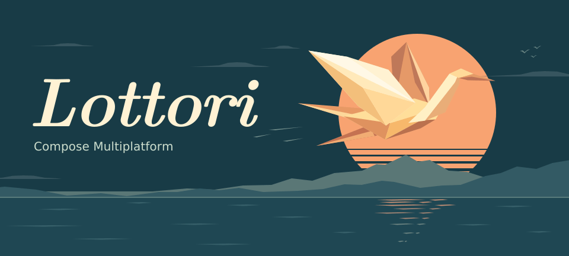
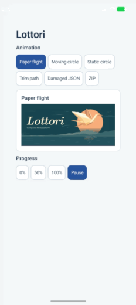
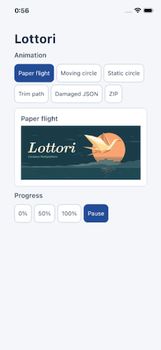

# Lottori

**English** · [한국어](README.ko.md) · [日本語](README.ja.md)

[](docs/assets/paper-flight.json)

Lottori is a Kotlin library for drawing 2D Lottie icons in Compose on Android and iOS. You can play an animation or set its progress from a gesture. By default, the loader rejects unsupported features and reports their JSON path and layer name so your app can show a fallback icon.

## Sample app recordings

The sample opens with **Paper flight**, a 5.2-second loop rendered from `paper-flight.json`. kyounghyunko created the animation using ChatGPT.

| [Android emulator (MP4)](docs/assets/paper-flight-android.mp4) | [iOS simulator (MP4)](docs/assets/paper-flight-ios.mp4) |
| --- | --- |
| [](docs/assets/paper-flight-android.mp4) | [](docs/assets/paper-flight-ios.mp4) |

## Platform support

| Platform | Minimum version | Playback tested on |
| --- | --- | --- |
| Android | Android 6.0 (API 23) for the library and demo app. Android 7.0 (API 24) for the Compottie benchmark app | Pixel 10 emulator running Android 16 |
| iOS | iOS 15.0 for the arm64 framework linked with the player. The sample app targets iOS 16.0 | iPhone 17e simulator running iOS 26.5 |

These minimums come from Android's `minSdk` and the `minos` recorded in the iOS device release binaries. Playback on the minimum OS versions is unverified. The iOS targets are `iosArm64` for devices and `iosSimulatorArm64` for Apple Silicon simulators.

| Dependency or tool | Version used to build and test |
| --- | --- |
| Kotlin Multiplatform and Compose Compiler plugin | 2.4.10 |
| Compose Multiplatform Runtime, UI and Foundation | 1.12.0 |
| kotlinx.serialization JSON and kotlinx.coroutines Core | 1.11.0 for both |
| Gradle, Android Gradle Plugin and JDK | 9.5.0, 9.1.1 and 21, respectively |
| Android SDK | `compileSdk = 37`, sample app `targetSdk = 36` |
| Xcode | 26.6 |

The consumer app uses the same Kotlin and Compose versions. Compatibility with older Kotlin versions is unverified. Only the benchmark app depends on Compottie lite 2.3.3. [Version catalog](gradle/libs.versions.toml) · [Benchmark configuration](docs/performance.md)

## Use Lottori in your app

### 1. Add the player to your shared module

Version `0.1.0-SNAPSHOT` is for local development. If your app and the Lottori checkout have the same parent directory, add this line to the app's `settings.gradle.kts`.

```kotlin
includeBuild("../lottori")
```

In the shared module, apply the Kotlin Multiplatform, Compose Compiler (`org.jetbrains.kotlin.plugin.compose`) and Compose Multiplatform (`org.jetbrains.compose`) plugins. Add the player and Compose Resources dependencies in `build.gradle.kts`.

```kotlin
kotlin {
    sourceSets.commonMain.dependencies {
        implementation("com.ycgc.lottori:lottori:0.1.0-SNAPSHOT")
        implementation("org.jetbrains.compose.components:components-resources:1.12.0")
    }
}
```

The player includes the JSON decoder. To inspect a file before playback, call `com.ycgc.lottori.core.decodeJson(bytes)` and read its `composition` and `diagnostics`.

### 2. Load a JSON file and display a frame

Place `paper-flight.json` in `src/commonMain/composeResources/files/` in the shared module. Android and iOS use the same file. Import the `Res` class generated for that module. For an Android KMP library target, enable Android resources with `kotlin { android { androidResources.enable = true } }`. [Paper flight JSON](docs/assets/paper-flight.json) · [Compose Resources setup](https://kotlinlang.org/docs/multiplatform/compose-multiplatform-resources-setup.html)

```kotlin
import androidx.compose.runtime.Composable
import androidx.compose.ui.Modifier
import com.ycgc.lottori.*

@Composable
fun PaperFlight(
    progress: () -> Float,
    fallback: @Composable () -> Unit,
    modifier: Modifier = Modifier,
) {
    when (val state = rememberLottoriComposition("files/paper-flight.json", Res::readBytes)) {
        LottoriLoadState.Loading -> Unit
        is LottoriLoadState.Failed -> fallback()
        is LottoriLoadState.Ready -> LottoriAnimation(
            composition = state.composition,
            progress = progress,
            modifier = modifier,
            contentDescription = "Paper crane in flight",
        )
    }
}
```

Call `PaperFlight` with `progress = { 0.5f }` to show the paper crane halfway through its flight. To drive the animation from a gesture, return its progress between 0 and 1 from the same lambda. Supply a static icon as `fallback`. On failure, `state.diagnostics` explains why loading failed.

The full resource path identifies the animation. To reload new bytes at the same path, pass an additional `key`, for example `rememberLottoriComposition(path, Res::readBytes, key = revision)`. Multiple players can share a loaded `composition`.

### 3. Play or pause an animation

For automatic playback, use this call in the `Ready` branch above. The default iteration count is 1. After the last iteration, the player holds the final frame.

```kotlin
LottoriAnimation(
    composition = state.composition,
    modifier = modifier,
    iterations = 3,
    isPlaying = true,
    contentDescription = "Paper crane in flight",
)
```

Bind `isPlaying` to screen state. Set it to `false` to pause and `true` to resume from the same position. To use the same progress elsewhere in the UI, share the `State<Float>` returned by `rememberLottoriPlayback`. The player centers the animation using `ContentScale.Fit` by default. Use `contentDescription = null` for decorative icons.

## Inspect a file

With JDK 21 and Android SDK Platform 37 installed, run these commands from the repository root.

```sh
./gradlew :lottori-check:run --args='docs/assets/paper-flight.json'
./gradlew :lottori-check:installDist
lottori-check/build/install/lottori-check/bin/lottori-check fixtures/trim-path.json
lottori-check/build/install/lottori-check/bin/lottori-check --preview fixtures/trim-path.json
```

The default mode is `Strict`. For `trim-path.json`, the checker reports `TrimPath` at `$.layers[0].shapes[0].it[1]` in layer `checkmark` and exits with code 1. In `Preview` mode the checker keeps the warning and skips the affected layer and its dependent children. For a matte, it skips both the source and the target. Both modes fail if the matte target is ambiguous or a parent reference is invalid.

## v0.1 feature support

| Area | Supported features | Fixture and reference frames |
| --- | --- | --- |
| Input | UTF-8 JSON bytes without a filename, Bodymovin `v`, integer specification version `ver`, warnings for unknown versions | [Static circle](fixtures/static-circle.json) · [Reference frame](fixtures/frames/web/static-circle-000.png) |
| Layers and transforms | Shape layers, null parents, visibility intervals, default start time and time stretch, anchor, position, scale, rotation, opacity and nested groups | [Overlapping shapes and parent rotation](fixtures/render-order.json) · [Reference frame](fixtures/frames/web/render-order-050.png) |
| Shapes and styles | Rectangles with square or rounded corners, ellipses, static Bézier paths, solid fills and strokes, fill rules, line caps and joins, group opacity | [Closed curves and holes](fixtures/render-order.json) · [Reference frame](fixtures/frames/web/render-order-050.png) |
| Timing | Constant scalar and 2D vector values, hold and linear interpolation, per-axis temporal Bézier easing, fractional frames | [Timing fixture](fixtures/timing.json) · [Midpoint frame](fixtures/frames/web/timing-050.png) |
| Playback | External progress, one-shot and repeated playback, pause and resume, accessibility descriptions | [Moving circle](fixtures/moving-circle.json) · [0%](fixtures/frames/web/moving-circle-000.png) · [50%](fixtures/frames/web/moving-circle-050.png) · [100%](fixtures/frames/web/moving-circle-100.png) |

ZIP input returns `UnsupportedContainer`. The player does not support dotLottie JSON extraction, themes or state machines. The loader also diagnoses the following unsupported visual features.

- Precompositions, solid, image, text and 3D layers, non-default `st` or `sr`, and time remapping.
- Split position, skew, auto-orient, spatial motion curves, path morphing, stars, trim paths and repeaters.
- Gradients, dashes, blend modes, masks, mattes, expressions and animated colors.

The loader accepts metadata. It also reports reversed custom paths and parent styles that cross a translucent subgroup boundary as unsupported.

## Run the sample and tests

The **Moving circle** fixture moves at 30 fps over the frame interval `[10, 40)`. At 0%, 50% and 100% progress, the player displays frames 10, 25 and 39, placing the center at x coordinates 20, 50 and 78. Progress beyond the last displayable frame holds that frame. [Sample app instructions](sample/README.md)

```sh
./gradlew :lottori:jvmTest
./gradlew :lottori:iosSimulatorArm64Test
ANDROID_SERIAL=emulator-5554 ./gradlew :lottori:connectedAndroidDeviceTest
```

[Generate reference images](docs/frames.md) · [Download size](docs/size.md) · [Playback performance](docs/performance.md) · [Original design](docs/Lottori-design.md)

## Verify a release candidate

Publish the library to the local verification Maven repository. Then build the separate consumer project against the published Android and iOS packages and their transitive dependencies.

```sh
./gradlew checkLegacyAbi publishAllPublicationsToVerificationRepository
./gradlew -p verification/consumer assembleAndroidMain compileKotlinIosArm64 compileKotlinIosSimulatorArm64
```

The code and project-authored fixtures use the Apache 2.0 license. When contributing a feature, include a minimal JSON fixture, the expected frame, render results from Android and iOS, and an update to the support table above. [License](LICENSE)
